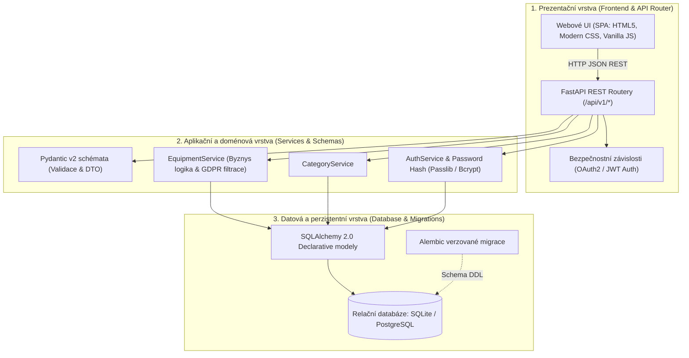
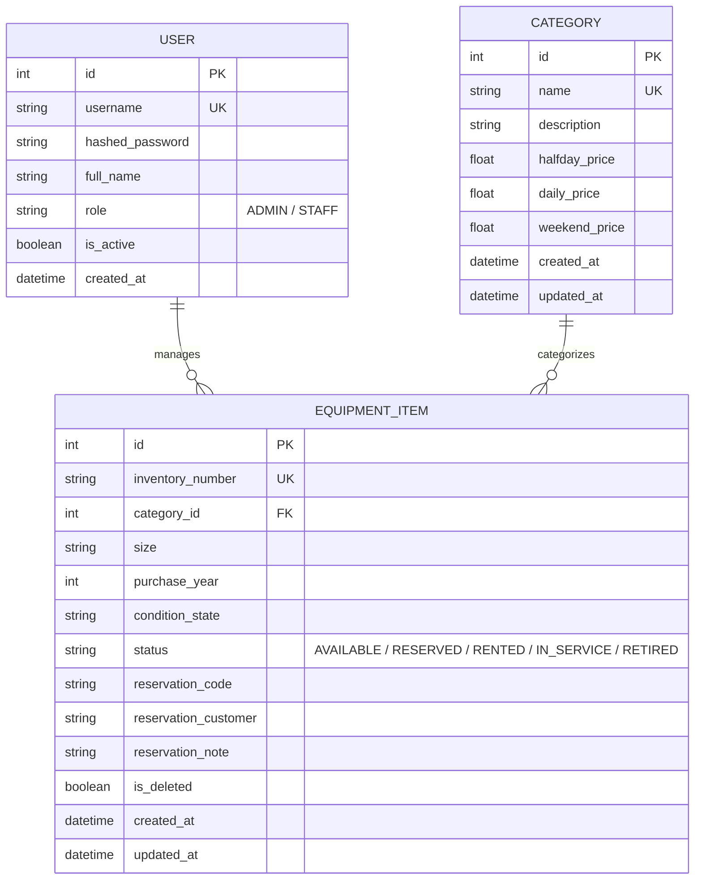
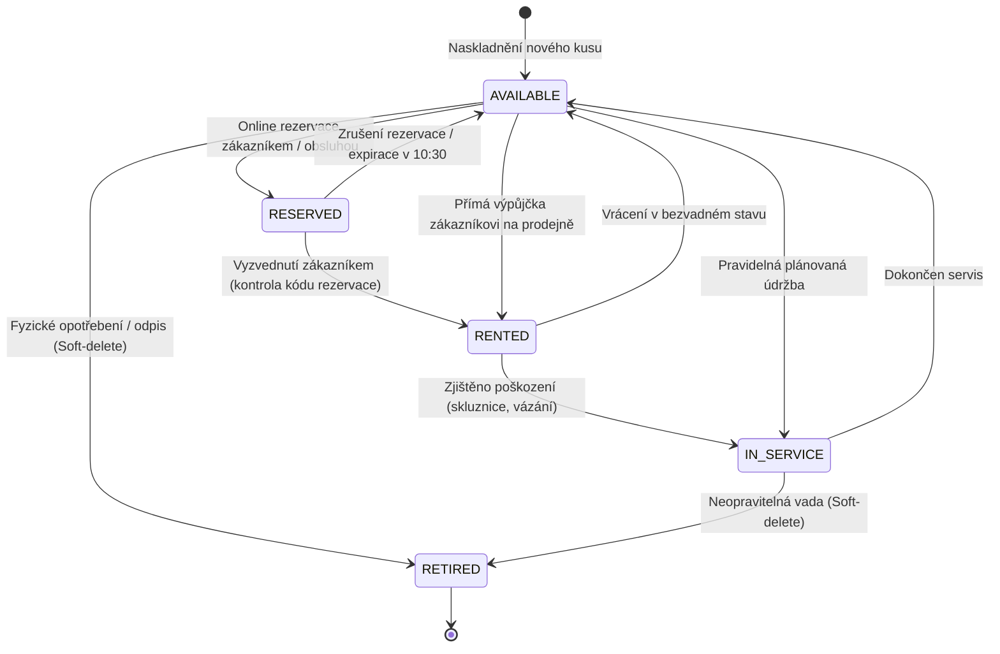

# Systémová a technická dokumentace projektu
## Půjčovna sportovního vybavení „Hory a voda“ (Varianta D)

Tento dokument představuje ucelenou systémovou, architektonickou a uživatelskou dokumentaci aplikace pro půjčovnu sportovního vybavení v rámci semestrálního projektu předmětu **Pokročilé programování (PPRO)** na **FIM UHK** (ZS 2026/2027).

---

## Obsah

1. [Úvod a doménový kontext](#1-úvod-a-doménový-kontext)
2. [Třívrstvá architektura a technologický stack](#2-třívrstvá-architektura-a-technologický-stack)
3. [Datový model a životní cyklus inventáře](#3-datový-model-a-životní-cyklus-inventáře)
4. [Bezpečnost, role a ochrana osobních údajů (GDPR)](#4-bezpečnost-role-a-ochrana-osobních-údajů-gdpr)
5. [Specifikace REST API endpointů](#5-specifikace-rest-api-endpointů)
6. [Webové uživatelské rozhraní (Frontend)](#6-webové-uživatelské-rozhraní-frontend)
7. [Návod k instalaci, spuštění a testování](#7-návod-k-instalaci-spuštění-a-testování)
8. [Architektonická rozhodnutí (ADR)](#8-architektonická-rozhodnutí-adr)

---

## 1. Úvod a doménový kontext

Půjčovna sportovního vybavení **Hory a voda s.r.o.** zajišťuje celoroční servis a zapůjčování outdoorové výstroje:
- **Zimní sezóna:** sjezdové lyže, skialpy, běžky, snowboardy, boty, hole, helmy.
- **Letní sezóna:** kánoe, nafukovací čluny (Pálava, Baraka), packrafty, pádla, plovací vesty a neopreny.

### Původní stav (AS-IS)
Před nasazením systému byla veškerá evidence vedena v papírových sešitech a rezervace přijímány telefonicky na papírky. V sobotních ranních špičkách vznikaly dlouhé fronty, docházelo ke kolizím termínů (tentýž kus slíben dvěma zákazníkům – overbooking) a personál neměl okamžitý přehled o stavu servisu a vrácených kusech.

### Cílový stav (TO-BE)
Webová aplikace poskytuje jednotné informační centrum:
- **Veřejným zákazníkům:** přehledný katalog ceníků, okamžité ověření dostupnosti inventáře a možnost vytvoření online rezervace bez nutnosti registrace.
- **Personálu (obsluze):** ranní přehledový dashboard (KPI statistiky), okamžité vyhledávání a filtrování podle stavu, kontrolu čísla rezervace při výdeji, evidenci vrácení a přepínání opotřebených kusů do servisu.
- **Správci (adminovi):** plnou kontrolu nad inventářem, ceníky a uživatelskými účty personálu.

---

## 2. Třívrstvá architektura a technologický stack

Projekt důsledně dodržuje **třívrstvou architekturu se striktně jednosměrným tokem závislostí**:



### Použité technologie

| Vrstva | Technologie | Odůvodnění |
| :--- | :--- | :--- |
| **Backend Framework** | **FastAPI (Python 3.14)** | Extrémní výkon, asynchronní podpora, automatická interaktivní dokumentace OpenAPI/Swagger, nativní validace vstupů. |
| **Validace a typování** | **Pydantic v2** | Typově bezpečný přenos dat (DTO), automatická serializace a konverze chyb. |
| **ORM a DB vrstva** | **SQLAlchemy 2.0** | Moderní deklarativní mapování s plnou typovou kontrolou; nezávislost na konkrétním SQL dialektu. |
| **Migrační nástroj** | **Alembic** | Řízené verzování databázového schématu garantující opakovatelnost nasazení. |
| **Databáze** | **SQLite (dev) / PostgreSQL (prod Docker)** | Flexibilní přenositelnost; spolehlivá transakční integrita ACID. |
| **Frontend** | **HTML5 + Modern CSS3 + Vanilla JS** | Nulová závislost na externích bundlerech, bleskové načítání, čistý editorial design inspirovaný Squarespace a Adobe. |
| **Kontejnerizace** | **Docker & Docker Compose** | Možnost okamžitého spuštění na jakémkoli systému jedním příkazem `docker compose up`. |
| **Testy a QA** | **Pytest + HTTPX TestClient** | Pokrytí integračními testy pro autentizaci, CRUD inventáře a GDPR maskování. |

---

## 3. Datový model a životní cyklus inventáře

### Entitně-vztahový diagram (ERD)



### Životní cyklus kusu vybavení (`EquipmentStatus`)



### Pravidla integrity a doménové podmínky:
1. **Unikátnost inventárního čísla:** Každý fyzický kus má unikátní označení (např. `SKI-001`), které se nesmí opakovat ani po smazání jiného kusu.
2. **Nemožnost kolizního půjčení:** Kus se stavem `RESERVED`, `RENTED` nebo `IN_SERVICE` je v rezervačním i půjčovním modulu automaticky zablokován a nelze jej znovu přiřadit jinému zákazníkovi.
3. **Měkké mazání (Soft-Delete):** Fyzické záznamy se z databáze nemažou (`is_deleted = True`), aby zůstala zachována historie pro účetnictví, amortizaci a statistiky.

---

## 4. Bezpečnost, role a ochrana osobních údajů (GDPR)

Systém striktně odděluje data pro veřejné zákazníky a pro interní personál:

```
┌────────────────────────────────────────────────────────────────────────┐
│                        MATICE PŘÍSTUPOVÝCH PRÁV                        │
├─────────────────────────┬──────────────┬──────────────┬────────────────┤
│ Operace / Pohled        │ Veřejnost    │ Obsluha      │ Administrátor  │
│                         │ (Anonym)     │ (STAFF)      │ (ADMIN)        │
├─────────────────────────┼──────────────┼──────────────┼────────────────┤
│ Prohlížení ceníku       │ ANO          │ ANO          │ ANO            │
│ Stav kusů (Volné/Rez.)  │ ANO (anonym) │ ANO          │ ANO            │
│ Osobní údaje zákazníků  │ ❌ SKRYTO     │ ANO          │ ANO            │
│ Seznam aktivních rez.   │ ❌ SKRYTO     │ ANO          │ ANO            │
│ Vytvoření rezervace     │ ANO          │ ANO          │ ANO            │
│ Výdej rezervace (půjčit)│ ❌ NE         │ ANO          │ ANO            │
│ Přepnutí do servisu     │ ❌ NE         │ ANO          │ ANO            │
│ Editace ceníků          │ ❌ NE         │ ❌ NE        │ ANO            │
│ Správa personálu        │ ❌ NE         │ ❌ NE        │ ANO            │
└─────────────────────────┴──────────────┴──────────────┴────────────────┘
```

### Opatření GDPR na úrovni API i UI:
- **Backendové maskování (Data Masking):** V endpointu `GET /api/v1/equipment/` a `GET /api/v1/equipment/{id}` probíhá dynamická detekce identity uživatele pomocí volitelného JWT tokenu (`get_current_user_optional`). Pokud uživatel není přihlášen jako personál (`current_user is None`), hodnoty `reservation_code`, `reservation_customer` i `reservation_note` jsou automaticky přepsány na `None / null`. Ani analýzou síťových požadavků v DevTools nelze získat jméno či telefon cizího zákazníka.
- **Frontendové zabezpečení:** Přehledová karta aktivních rezervací (`#card-active-reservations`) na rezervační záložce je pro nepřihlášené návštěvníky zcela skrytá. Zákazník v tabulce inventáře vidí pouze štítek `Rezervováno`, nikoliv to, kdo si kus rezervoval.
- **Bezpečná identifikace při výdeji:** Zákazník při převzetí na prodejně nahlásí unikátní číslo své rezervace (např. `REZ-2026-7562`). Obsluha ověří shodu s číslem v systému a kliknutím na tlačítko *„Vydat (půjčit)“* převede kus do stavu `RENTED`.

---

## 5. Specifikace REST API endpointů

Všechny endpointy začínají prefixem `/api/v1`. Interaktivní dokumentace je dostupná na `/docs`.

### 5.1 Autentizace (`/api/v1/auth`)
- `POST /api/v1/auth/login` – Přihlášení uživatele (OAuth2 password request: `username`, `password`). Vrací JWT `access_token` a typ role.
- `GET /api/v1/auth/me` – Zjištění profilu a oprávnění aktuálně přihlášeného uživatele (vyžaduje Bearer token).

### 5.2 Kategorie a ceník (`/api/v1/categories`)
- `GET /api/v1/categories/` – Seznam všech aktivních kategorií s platnými tarify (veřejné).
- `GET /api/v1/categories/{id}` – Detail kategorie (veřejné).
- `POST /api/v1/categories/` – Vytvoření nové kategorie (pouze `ADMIN`).
- `PUT /api/v1/categories/{id}` – Úprava sazeb ceníku a popisu (pouze `ADMIN`).
- `DELETE /api/v1/categories/{id}` – Deaktivace kategorie (pouze `ADMIN`).

### 5.3 Inventář a rezervace (`/api/v1/equipment`)
- `GET /api/v1/equipment/` – Seznam vybavení s volitelnými filtry (`category_id`, `status`). Maskuje osobní údaje pro nepřihlášené.
- `GET /api/v1/equipment/{id}` – Detail kusu. Maskuje osobní údaje pro nepřihlášené.
- `POST /api/v1/equipment/` – Zaevidování nového kusu (vyžaduje `STAFF` nebo `ADMIN`).
- `PUT /api/v1/equipment/{id}` – Úprava parametrů, změna stavu na `RENTED`, `IN_SERVICE`, `AVAILABLE` (vyžaduje `STAFF` nebo `ADMIN`).
- `DELETE /api/v1/equipment/{id}` – Soft-delete vyřazení kusu (vyžaduje `ADMIN`).
- `POST /api/v1/equipment/{item_id}/reserve` – **Veřejný rezervační koncový bod.** Umožňuje zákazníkovi zarezervovat dostupný kus. Zapisuje jméno, telefon, termín a generuje kód `REZ-YYYY-XXXX`.

---

## 6. Webové uživatelské rozhraní (Frontend)

Uživatelské rozhraní je navrženo ve stylu **editorial minimalismu** (inspirováno platformami jako Squarespace či Adobe) se světlým tématem (Light mode):

### Barevný a typografický systém
- **Alpine Amber (`#d97706` / `#f59e0b`):** Barva horského štítu, vitality a zvýraznění nejlepších tarifů.
- **Glacier Blue (`#0284c7`):** Barva ledovcové vody pro vodácké vybavení a vodní sporty.
- **Deep Slate / Ink (`#1c1917`):** Silná typografie, ostrá tlačítka a formální prvky.
- **Písma:** `Inter` pro přehledná data a texty; `JetBrains Mono` pro inventární čísla (`SKI-001`), kódy rezervací a kalkulované částky.

### Hlavní obrazovky (Záložky)
1. **Vybavení a inventář (Ranní přehledovka):**
   - Horní třetina s reprezentativním emblémem půjčovny a fotografií zázemí.
   - 4 KPI dlaždice: Celkem inventář, Okamžitě k dispozici, V servisu, Vypůjčeno / Rezervováno.
   - Okamžité textové vyhledávání a filtrování podle stavu bez znovunačítání stránky.
   - Plná šířka kontejneru (`1560px`), eliminující vodorovné posuvníky na standardních displejích.
2. **Rezervace vybavení:**
   - **Krok 1 (Výběr kusu):** Zákazník volí kategorii a velikost. Nabízeny jsou výhradně kusy ve stavu `AVAILABLE`.
   - **Krok 2 (Tarif a termín):** Volba časového bloku (Ranní půlden, Odpolední půlden, Celý den, Víkendový 2denní balíček).
   - **Krok 3 (Údaje zákazníka a kalkulace):** Zadání jména a telefonu, zobrazení souhrnného lístku s kaucí a cenou.
   - **Aktivní rezervace:** Tabulka s čekajícími rezervacemi k vyzvednutí se zobrazuje **výhradně přihlášenému personálu**.
3. **Ceníky a kategorie:**
   - Karty kategorií se strukturovanými tabulkami cen pro půlden, celý den a víkend, zarovnané čistě na spodní okraj karty.
   - Administrátorský modal pro přidávání nových kategorií.

---

## 7. Návod k instalaci, spuštění a testování

### 7.1 Rychlé spuštění v Dockeru (doporučeno pro odevzdání)

Ke spuštění celé aplikace a relační databáze stačí jediný příkaz:

```bash
docker compose up --build
```

Aplikace:
1. Spustí PostgreSQL databázi a vyčká na úspěšný healthcheck.
2. Aplikuje veškeré Alembic migrace na nejnovější verzi schématu.
3. Naplní databázi syntetickými daty (`python -m app.seed`).
4. Nastartuje webový server Uvicorn na adrese: **`http://localhost:8000/`**.

### 7.2 Lokální vývojové spuštění (Virtualenv)

Pokud chcete aplikaci spouštět lokálně v Python prostředí:

```bash
# 1. Příprava virtuálního prostředí
python3 -m venv venv
source venv/bin/activate

# 2. Instalace závislostí
pip install -r requirements.txt

# 3. Aplikace migrací schématu
alembic upgrade head

# 4. Naplnění výchozími daty (kategorie, inventář, účty)
python -m app.seed

# 5. Spuštění serveru
uvicorn app.main:app --reload --port 8000
```

Webová aplikace je následně dostupná na `http://localhost:8000/`.

### 7.3 Výchozí syntetické přihlašovací účty

| Uživatelské jméno | Heslo | Role | Určení |
| :--- | :--- | :--- | :--- |
| **`obsluha`** | `Heslo123!` | `STAFF` | Pultový personál půjčovny (výdej, vrácení, rezervace, servis) |
| **`admin`** | `Admin123!` | `ADMIN` | Vedoucí provozu (kompletní práva, ceníky, správa účtů) |

### 7.4 Spuštění automatizovaných testů

Sada testů ověřuje bezpečnostní pravidla, byznys logiku a GDPR maskování:

```bash
pytest -v
```

Testy pokrývají:
- Přihlášení a generování JWT tokenů (`test_auth.py`).
- Omezení přístupu pro neautorizované požadavky.
- Zákaz duplicitních inventárních čísel.
- Měkké mazání (Soft-delete).
- Změnu stavu na `IN_SERVICE`.
- Veřejnou rezervaci kusu a ochranu osobních údajů (maskování hodnot `reservation_code`, `reservation_customer` a `reservation_note` pro anonymní návštěvníky).
- Zákaz rezervace již obsazeného kusu.

---

## 8. Architektonická rozhodnutí (ADR)

Systém vychází ze série odsouhlasených architektonických rozhodnutí dokumentovaných v `README.md`:

- **ADR-001 (Dvoufázová alokace rezervací):** Rezervace váže konkrétní fyzický inventární kus pro zajištění 100% spolehlivosti proti overbookingu. Obsluha má možnost kus při fyzickém výdeji operativně zaměnit.
- **ADR-002 (Ochranná lhůta rezervace):** Rezervace je garantována v den začátku výpůjčky do 10:00 s tolerancí 30 minut (do 10:30). Poté může být nevyzvednutý kus uvolněn pro čekající zákazníky ve frontě.
- **ADR-006 (Časové bloky):** Podpora 4 standardních tarifních bloků: půlden dopolední (08–13h), půlden odpolední (13–18h), celý den a víkendový balíček (pátek 14h až neděle 18h).
- **ADR-007 (Technologický stack):** Volba Python 3, FastAPI, SQLAlchemy 2.0, Alembic a Docker Compose.
- **ADR-008 (Firemní identita a layout):** Zavedení oficiálního názvu „Půjčovna sportovního vybavení Hory & Voda“, rozšíření pracovního kontejneru na `1560px` a eliminace horizontálního scrollu, editorial Light mode bez AI oválů.
- **ADR-009 (Ochrana osobních údajů zákazníků a GDPR):** Striktní maskování klientských údajů a rezervačních kódů pro anonymní návštěvníky přímo na úrovni backendu a úplné skrytí interního seznamu rezervací před nepřihlášenými uživateli.
- **ADR-010 (Responzivní mobilní zobrazení pro telefony):** Dvouúrovňová mobilní navigace se samostatnou řadou pro značku a uživatelský profil a rozbalovacím menu (drop-down menu) pro hlavní stránky (Ranní přehled, Rezervace, Ceníky). Rozbalovací menu nahrazuje původní vodorovný posuvník (slider), čímž je volba sekcí na smartphonech okamžitě zřejmá a intuitivní bez nutnosti horizontálního posouvání, zatímco desktopová verze pro PC zůstává plně zachována.

---
*Dokumentace vypracována pro potřeby předmětu Pokročilé programování (PPRO), FIM UHK.*
